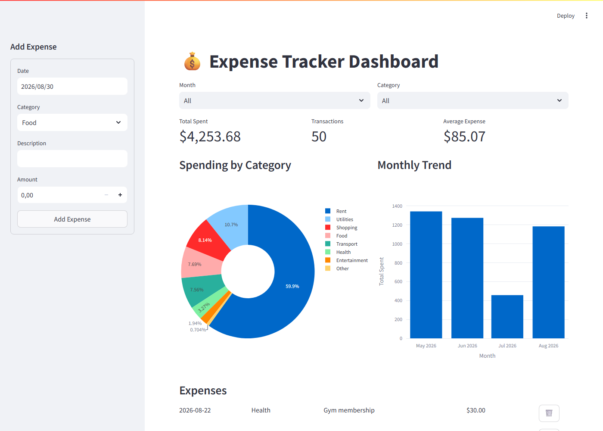
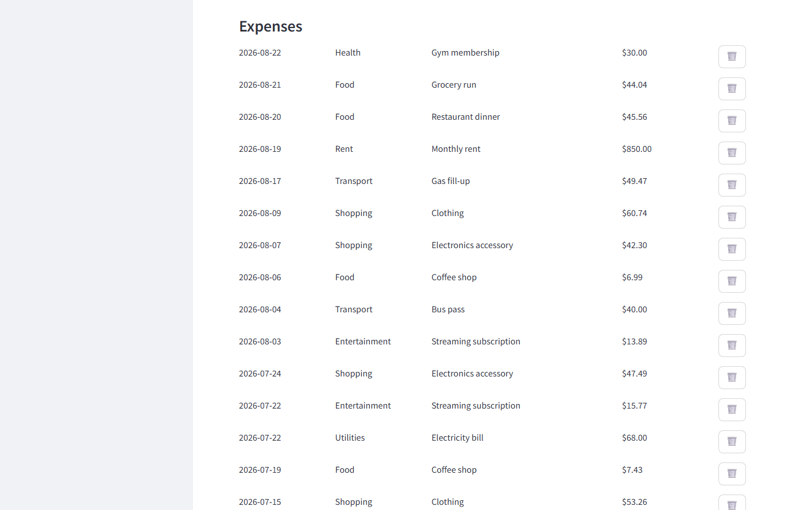

# Expense Tracker Dashboard

A Streamlit app for freelancers and small business owners to log personal
or business expenses by category and instantly see where the money is
going — total spent, spending by category, and the monthly trend — without
touching a spreadsheet. Every expense persists in a local SQLite database
between sessions.

## What it solves

Tracking expenses in a spreadsheet works until it doesn't: no live totals,
no charts, and it's easy to lose track of which month is which. This app
replaces that with a guided flow:

1. Log an expense from the sidebar (date, category, description, amount).
2. Filter the dashboard by month and/or category.
3. See the total spent, transaction count, and average expense update
   instantly as KPI cards.
4. View a category breakdown (pie chart) and a monthly spending trend
   (bar chart) for the selected filter.
5. Browse, delete, or export the filtered expense list to Excel at any
   time — nothing is locked into the app.

## Tech stack

- **Streamlit** — the interactive form, filters, and dashboard.
- **SQLite** (via the standard library `sqlite3`) — stores expenses with
  indexes on date and category so filtering and aggregation stay fast as
  the table grows.
- **Plotly** — the category pie chart and monthly trend bar chart.
- **pandas / openpyxl** — powers the Excel export.

## How it works

- [`app.py`](app.py) — the Streamlit UI: the "Add Expense" form, filters,
  KPI cards, charts, and the expense table with delete/export actions.
- [`db.py`](db.py) — all SQLite access: schema creation, inserts, deletes,
  and the aggregation queries. Category and monthly totals are computed
  with SQL `GROUP BY` (a single query each), not by looping over rows in
  Python — that stays fast even with years of history instead of a demo
  dataset.
- [`export.py`](export.py) — builds the filtered expense list into an
  in-memory `.xlsx` file for the download button, with auto-sized columns.
- [`seed_demo_data.py`](seed_demo_data.py) — optional helper that fills the
  database with a few months of realistic sample expenses, used only to
  populate the dashboard for the screenshots below (not part of the app).

## Preview





## Running it locally

```bash
py -3.12 -m venv venv
.\venv\Scripts\python.exe -m pip install -r requirements.txt
.\venv\Scripts\python.exe -m streamlit run app.py
```

The app opens in your browser at `http://localhost:8501`. A local
`expenses.db` file is created automatically on first run. To try it with
sample data first, run `.\venv\Scripts\python.exe seed_demo_data.py` before
starting the app.

## Adapting it to a real business

- Replace the fixed `CATEGORIES` list in [`db.py`](db.py) with categories
  that match the business, or load them from a settings table if they
  need to be editable from the UI.
- Add a monthly budget per category and highlight overspending on the
  dashboard.
- Add authentication (e.g. `streamlit-authenticator`) if more than one
  person needs a separate, private expense history.
- Swap SQLite for PostgreSQL/MySQL in `db.py` if the app needs to run on a
  shared server instead of a single machine.

## Portfolio note

Built as a portfolio piece to demonstrate an interactive dashboard backed
by relational persistence and SQL-side aggregation — not a static report.
Part of a series of daily automation projects; see the
[full portfolio](https://github.com/Camil0Camp0s?tab=repositories) for
more.

## License

See [LICENSE](LICENSE). Published for portfolio and educational purposes
— not for commercial reuse without permission.
